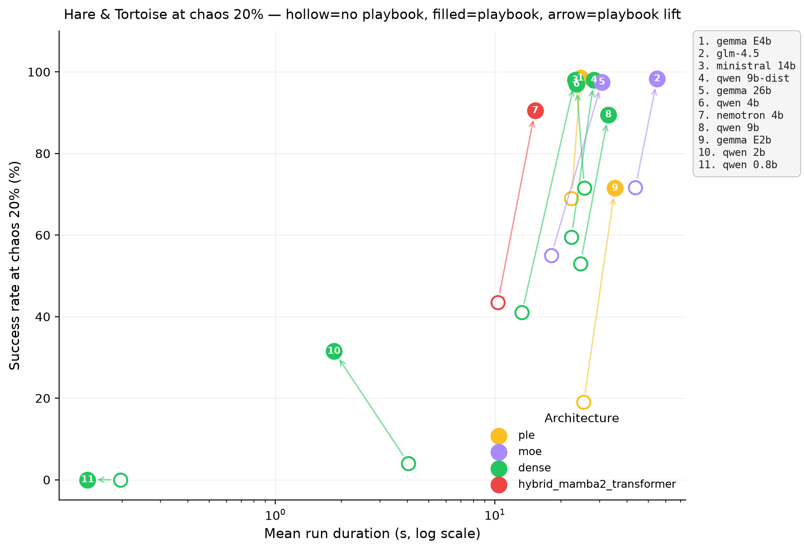
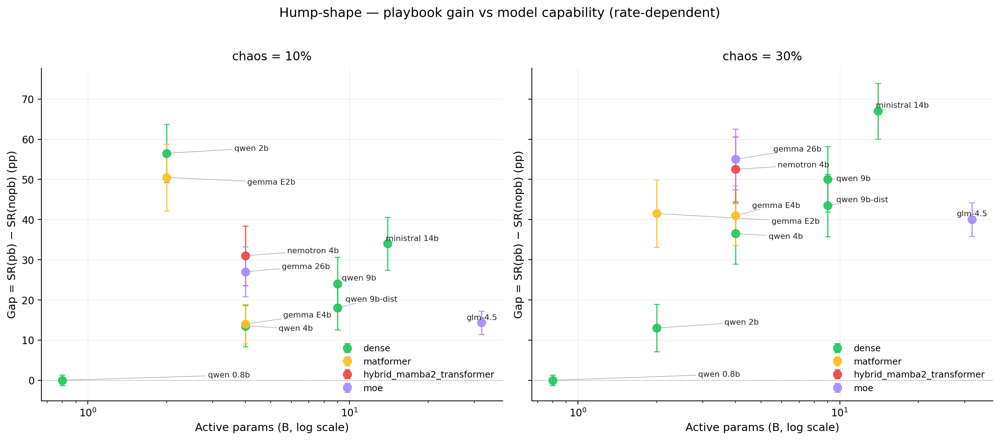
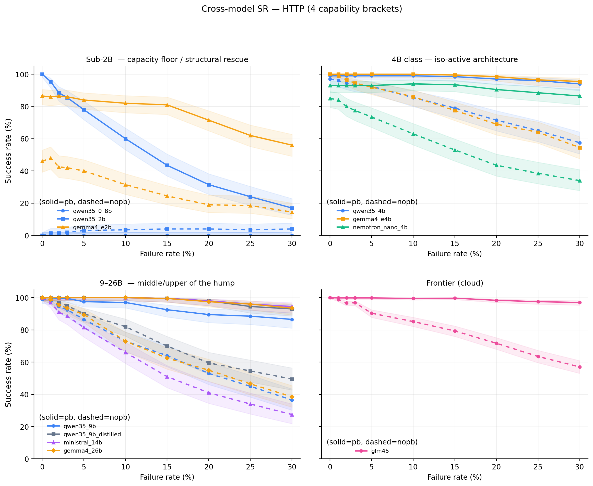
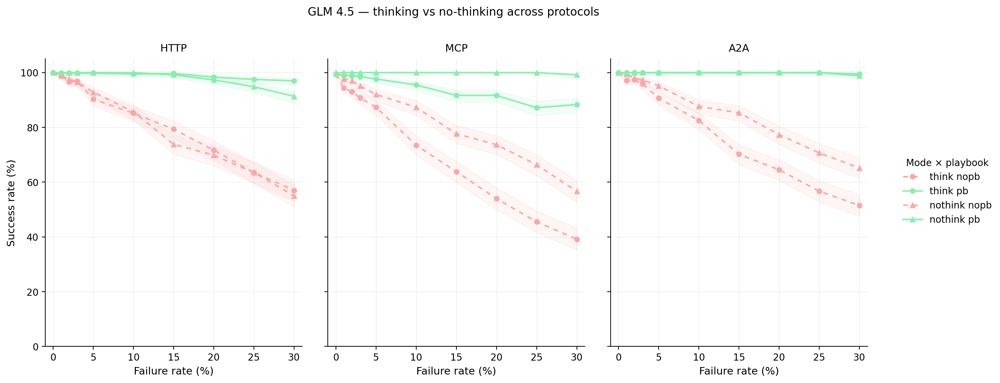
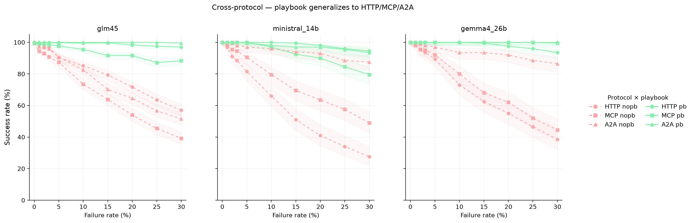
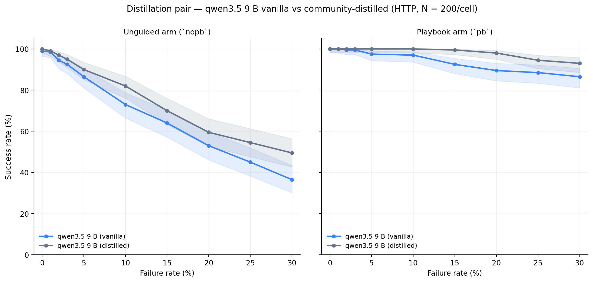
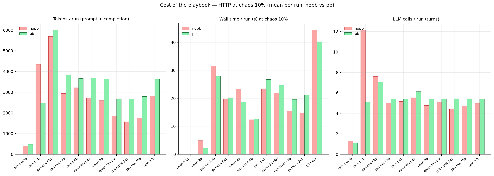
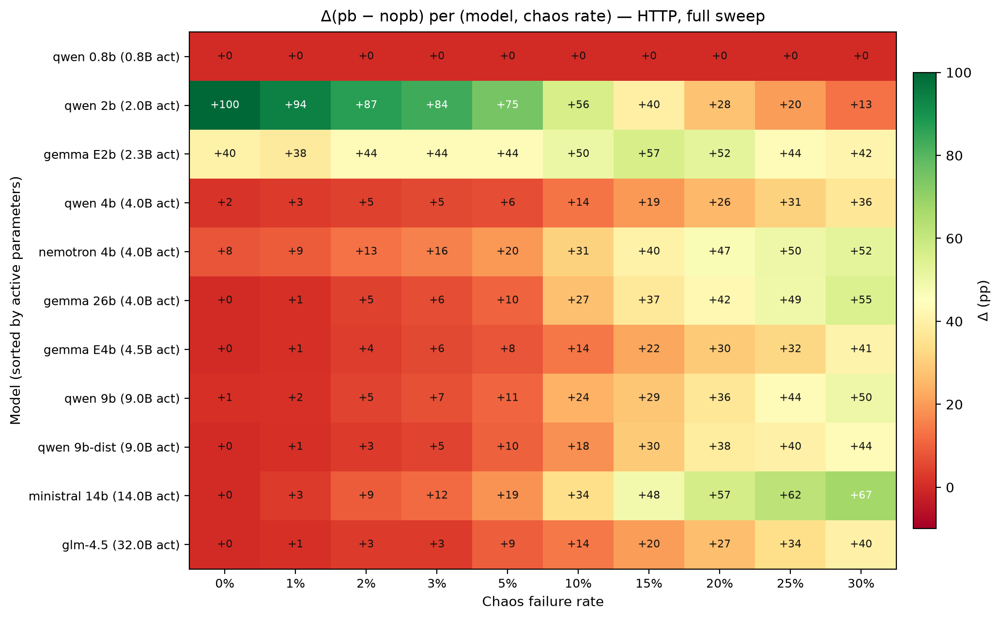

<hr />

# Mapping LLM-agent reliability under chaos: a cross-architecture study of structured recovery playbooks

<p class="subtitle">Chaos Playbook Lab — Working Paper 1</p>

<hr />

<div class="sidestamp">Chaos Playbook Lab &middot; Working Paper 1 &middot; v1.0 &middot; 2 July 2026</div>

<p class="author">Alberto Martínez Zurita &middot; Alessandro Russo</p>

<p class="affil">Chaos Playbook Lab</p>

<p class="date">First version: 19 May 2026 &nbsp;·&nbsp; This version: 2 July 2026 (v1.0)</p>

<p class="availability">Code, dataset and figures: <a href="https://github.com/alberto-martinez-zurita/chaos-playbook-lab">github.com/alberto-martinez-zurita/chaos-playbook-lab</a></p>

---

# Abstract

LLM-driven agents are increasingly deployed as autonomous executors of multi-step business workflows, yet their reliability under realistic operational chaos — flaky tool calls, timeouts, transient server errors — remains poorly characterised. We treat **chaos engineering as a scientific instrument** for exposing this reliability surface, and report a controlled study across **eleven open and frontier LLMs** (0.8 B → 355 B parameters; dense, MoE and MatFormer architectures), three agent transport protocols (HTTP, MCP, A2A) and ten injected failure rates from 0 % to 30 %.

For each model we run an A/B comparison between an unguided agent (`nopb`) and the same model executing under a small structured **recovery playbook** (`pb`), totalling 128.0 K active agent runs. Three findings emerge. **(i)** The playbook closes the chaos-induced failure gap across the active roster: over the **functioning roster** (n = 9 — i.e. the active roster minus the qwen3.5 0.8 B capacity-floor case and the qwen3.5 2 B structural-rescue caveat), median Δ(pb−nopb) at 30 % chaos is **+43.5 percentage points** (bootstrap 95 % CI [40.0, 55.0]), with no model harmed by the playbook at any rate we tested. **(ii)** The benefit is *not* monotonic in capability — we observe a **hump** most cleanly at high chaos: 4 B–26 B dense and MoE models gain the most at chaos = 30 % (+36 to +67 pp, peak at 14 B), the 0.8 B floor cannot follow either arm (capacity floor), and a frontier 355 B/32 B-active model saturates earlier (+40 pp at 30 % chaos but only +14 pp at 10 %). **(iii)** Operational cost is modest and predictable — the playbook adds 13 %–69 % more tokens per run (mean ≈ 42 %) and +0.57 extra LLM calls on average; wall time is model-dependent (faster for two models, up to +43 % for the most reasoning-intensive cells).

We also document a *capacity floor* (qwen3.5 0.8 B fails the task at 0 % chaos in both arms) and a *structural-rescue artefact* (qwen3.5 2 B has nopb = 0 % at chaos = 0 % because it cannot emit valid structured output without the playbook). The chaos rig and playbook spec are released as open source.

**Keywords**: chaos engineering, LLM agents, reliability, recovery playbook, MCP, A2A.


# 1 Introduction

## 1.1 Why chaos, why now

Agentic LLM stacks — a model orchestrating a sequence of tool calls against external systems — are no longer a research curiosity. They underpin retrieval-augmented assistants, IDE copilots, customer-support bots, ETL repairers and a growing class of business-process automation. Yet the deployment story for these stacks still rests on two implicit assumptions:

1. The model is *good enough* to recover from the kind of imperfect tool behaviour that real production environments exhibit (timeouts, malformed JSON, half-applied writes, race conditions, transient HTTP 5xx).
2. Standard benchmarks (GSM8K [20], MMLU [19], HumanEval [21], agentic suites such as τ-Bench [18] or SWE-Bench [13]) are *informative enough* about that recovery behaviour to inform model-selection and architecture decisions.

We argue both assumptions are weak. Standard benchmarks measure an agent's behaviour on a happy path. Reliability under chaos — partial failures, redelivery, drift between protocol layers — is qualitatively a different surface. It is the surface that determines whether a deployed agent compounds errors silently or recovers gracefully, and it is the surface that an SRE actually watches.

Chaos engineering [1, 3], in the Netflix / Principles-of-Chaos sense, was built precisely to probe this surface for distributed systems. Our contribution here is to **treat chaos engineering as a scientific instrument**, not a production hardening tool, and use it to expose the reliability landscape of LLM agents.

## 1.2 The instrument

We build a transparent, deterministic chaos rig (open-sourced as `chaos-engine`) that injects a controlled rate of fault into the path between the LLM agent and its tools. The faults are intentionally simple and explicitly signalled — HTTP error codes (5xx, 408/504 timeouts, 429), typed MCP errors (`timeout`, `rate_limited`, `internal_error`) and typed A2A errors (`timeout`, `task_rejected`, `partial_failure`) — and the injection mechanism is protocol-agnostic: the same seed-controlled rig design applies whether the agent talks HTTP, MCP or A2A. A single knob — the **failure rate** — sweeps from 0 % to 30 % per tool call. Around the rig we run a fixed multi-step task and an A/B comparison between two agents:

- **`nopb` (unguided)**: the model is told what tools exist and asked to complete the task. It receives no recovery instructions.
- **`pb` (playbook)**: the model is given a small structured **recovery playbook** — a few hundred tokens describing how to recognise tool failures, how to retry, how to verify, and how to give up gracefully.

Both arms run on the *same model*, the *same prompt skeleton* and the *same chaos seed schedule*. Differences in success rate, token cost and wall time are therefore attributable to the playbook itself.

## 1.3 What this paper claims

We sweep this instrument across **eleven LLMs** spanning three orders of magnitude (0.8 B → 355 B total parameters), three architecture families (dense, Mixture-of-Experts, MatFormer), two providers' reasoning modes (think / nothink toggle), and three transport protocols (HTTP, MCP, A2A). The full dataset is **128.0 K active agent runs** (plus 800 appendix runs from an excluded model, §3.6), all released as raw CSVs alongside this paper.

Three concrete contributions:

1. **The playbook generalises.** Across every active model we measure, the structured recovery playbook closes the chaos-induced failure gap. The improvement at 30 % chaos, over the **functioning roster** (n = 9 — i.e. the active roster minus the capacity-floor qwen3.5 0.8 B and the structural-rescue qwen3.5 2 B documented in §5.3), has median **+43.5 pp**; including the two caveat cases the full active-roster range is +0 pp (qwen3.5 0.8 B, capacity floor) to +67 pp (Ministral 14 B). No model is harmed by the playbook at any rate we tested.
2. **The benefit is non-monotonic in capability.** The Δ(pb − nopb) traces a hump: a 0.8 B model is below the floor (cannot follow the task at all), 4 B–26 B models gain the most, and a 355 B-parameter frontier model saturates earlier. We characterise the shape and discuss its implications for model selection.
3. **The cost is bounded and predictable.** The playbook adds 13 %–69 % more tokens per run (mean ≈ 42 %) and +0.57 extra LLM calls on average (range +0.25 to +0.98 calls / run). Wall time is broadly comparable but model-dependent — some models run *faster* with the playbook (qwen3.5 4 B: −20 %; GLM 4.5 nothink: −7 %), others moderately slower (Ministral 14 B: +27 %, Gemma 4 26 B: +43 %). This makes the playbook a reasonable default for any deployed agent that values reliability over a single-digit percentage of inference cost.

Two negative findings deserve attention:

- A **capacity floor**: qwen3.5 0.8 B fails the task at 0 % chaos in both arms. The playbook cannot rescue a model that cannot follow the original instructions.
- A **structural-rescue artefact**: qwen3.5 2 B's nopb arm scores 0 % at chaos = 0 % because the model cannot emit valid structured output for the task without explicit guidance. The +56 pp gap at chaos = 10 % is largely the playbook fixing a *format* problem rather than a *chaos* problem. We surface this caveat in §5.

A third model (`gpt-oss-20b`) is excluded from comparative analysis because it enters a `?????`-loop mode collapse at chaos ≥ 0.25; details and rationale in §3.6.

## 1.4 Roadmap

§2 places the work in context. §3 describes the task, the playbook spec, the chaos rig and the model roster. §4 is the empirical core (Figs 2–9). §5 discusses caveats, threats to validity and what the hump means for practitioners. §6 closes with future directions. All figures and tables are auto-generated from `experiments/` by `scripts/generate_paper_figures.py`; regenerating the paper graphics is one shell command.


# 2 Related work

This paper sits at the intersection of three communities. We summarise each line briefly and explain how this work differs.

## 2.1 Chaos engineering for distributed systems

Chaos engineering originated as a production-hardening practice at Netflix in the early 2010s with Chaos Monkey [2] and was formalised in the *Principles of Chaos Engineering* [3] and the IEEE Software treatment [1]. Subsequent work generalised the approach to controlled fault injection in production-grade platforms [6, 7, 8], to formal models of failure modes such as Lineage-Driven Fault Injection [4, 5], and to safety arguments around blast-radius control. The standard target is *infrastructure*: kill a pod, throttle a network link, pause a process, return 5xx with probability *p*.

Our work inherits the philosophy — *inject controlled fault and observe* — and the methodological discipline (deterministic seeding, paired control runs, bounded blast radius). It departs in the *target*: we inject at the **agent ↔ tool boundary** of an LLM stack, not at the infrastructure level. The fault model is consequently different: transient failures surfaced through the tool-call channel itself — HTTP 5xx and timeout codes, typed MCP/A2A errors such as `rate_limited` or `task_rejected` — the failure modes a real LLM agent encounters when its tools are flaky.

A small set of **concurrent** works has begun exploring this direction in the past nine months: ReliabilityBench [38] (Jan 2026) injects timeouts, rate limits, partial responses and schema drift at the tool boundary across two frontier APIs (Gemini 2.0 Flash, GPT-4o) over 1,280 episodes; Hell or High Water [39] (Aug 2025, COLM) benchmarks agent recovery when functions disappear or fail mid-trajectory; AgentNoiseBench [40] (Feb 2026) categorises noise into user-noise and tool-noise on an automated pipeline. Our contribution differs on four axes: (i) **scale** (128 K runs vs ~1,300 episodes in ReliabilityBench), (ii) **roster breadth** (11 open-weight models spanning 0.8 B – 355 B vs 2 frontier APIs), (iii) **explicit A/B with a structured recovery playbook** (a methodological lever absent in the concurrent works), and (iv) **cross-protocol coverage** (HTTP/MCP/A2A). The hump-shape, frontier-saturation, MCP-under-reasoning and distillation-pair findings (§4) follow from those four levers and have, to our knowledge, no parallel in the concurrent literature.

## 2.2 LLM agent reliability and benchmarks

The LLM-agent literature has produced an expanding family of benchmarks: **SWE-Bench** [13] (software engineering), **AgentBench** [14], **WebArena** [15], **OSWorld** [17], **τ-Bench** [18] (multi-turn business-process completion), **GAIA** [16], and so on. These suites measure end-to-end task success on a set of golden trajectories with deterministic environments. They have driven real progress in tool-use and planning ability, but by construction they say very little about behaviour under *operational* chaos: the environments are clean, tools always work, and a single failure mode (the model itself) is varied.

A second strand examines *robustness* via prompt perturbations or adversarial inputs (e.g. red-team studies of jailbreaks, prompt-injection benchmarks [35]). These adversarially manipulate the *input* to the model. Our axis is orthogonal: we keep prompts fixed and adversarially manipulate the *tool responses* the agent receives mid-trajectory.

A third strand, closest in spirit, instruments single agents with introspective recovery loops (ReAct [9], Reflexion [10], Tree-of-Thoughts variants for agents [11]). Those works *invent* recovery behaviour by adding model-side reasoning. Our work asks the complementary question: given a fixed model, how much of the recovery gap can we close with a *small, externally provided* recovery playbook? The playbook is a few hundred tokens; the experiment is comparable across architectures because the model is held fixed.

## 2.3 Scaling, distillation and reasoning

A large body of work studies how capability emerges with scale — Chinchilla compute-optimality [22], distillation studies [23], elastic-inference architectures such as MatFormer [24] and sparse-MoE architectures such as Mixtral [25], and the recent literature on inference-time reasoning (chain-of-thought [12], deliberation, "thinking" toggles in Qwen 3.5 [26], GLM 4.5 [28], Gemma 4 [27]). These findings live in the world of *clean* benchmarks.

We sweep the same axes — total parameters, active parameters, dense vs MoE vs MatFormer, distilled vs original, think vs nothink — under chaos. The result is a different empirical picture than the clean-benchmark literature suggests. Notably:

- The **hump** we observe (4 B–26 B benefits most from the playbook, frontier saturates) does not appear on clean benchmarks where capability is monotonic in scale.
- A **distillation pair** in our roster (qwen3.5 9 B vs a community-distilled 9 B variant) shows the distilled variant *uniformly above* the original on the `nopb` arm, with the gap widening from +1 pp at chaos = 0 % to +13 pp at chaos = 30 %. Distillation preserves chaos resilience at the 9 B point and, modestly, improves it at high chaos.
- A **think/nothink** toggle on the same frontier model (GLM 4.5) does not change the playbook's marginal value as much as one might expect.

We treat these as empirical contributions to the scaling-laws literature, not as definitive theory.

## 2.4 EU AI Act and operational evidence

A pragmatic motivation: the EU AI Act [34] (Articles 9, 10, 14, 15) requires deployers of high-risk AI systems to provide evidence of robustness, risk-management procedures and human oversight. Two recent legal-and-ML analyses [42, 43] examine how Articles 15 (high-risk) and 55 (general-purpose AI) should be operationalised and explicitly identify that the Act calls for "benchmarks and measurement methodologies" without prescribing them. Existing practice for LLM systems leans heavily on output-quality evaluations and red-teaming reports; chaos evidence — *what does the agent do when its tools misbehave?* — is conspicuously absent from both prescriptive guidance and proposed assurance frameworks (e.g. ontology + assurance-case approaches [42] focus on documentation rather than active testing). We frame the rig and the released CSV dataset as a candidate template for the measurement-methodology gap. §5.7 returns to this.

## 2.5 What this paper is *not*

To set expectations: this is **not** a paper about a new model, a new training recipe, or a new agent framework. The framework is deliberately minimal. The contribution is the *measurement methodology* and the *empirical map* it produces. The instrument and the data are the artefact.


# 3 Methodology

## 3.1 The task

The system under test is an LLM agent executing a deterministic four-step business workflow modelled on the OpenAPI Petstore reference:

| # | Step | Endpoint (HTTP) | Purpose |
|---|---|---|---|
| 1 | `FIND_PRODUCT`   | `GET  /product/find`     | Resolve a product by query string. |
| 2 | `CHECK_INVENTORY`| `GET  /store/inventory`  | Confirm stock for the resolved product. |
| 3 | `PLACE_ORDER`    | `POST /store/order`      | Place the order, receive an order id. |
| 4 | `CONFIRM_ORDER`  | `PUT  /order/confirm`    | Verify the order was committed. |

The four-step shape is intentionally minimal but realistic: each step depends on the previous one (the `order_id` from step 3 is a parameter to step 4), so a failed intermediate call derails the rest of the trajectory unless the agent recognises the failure and recovers before moving on.

A run is **successful** if and only if the agent completes all four steps in order — each call returning a non-error response — within the run's turn budget. Anything else — an injected fault the agent never recovers from, an explicit abort, an unparseable action, or an exhausted turn budget — is recorded as `failure`, together with the exact step at which the run failed (`failed_at`) and the steps completed before that (`steps_completed`). Success therefore measures **trajectory completion under chaos**: the oracle validates the call choreography, not the semantic consistency of every field the agent carries between steps. Parameter-chaining fidelity (e.g. reusing the `order_id` from step 3 in step 4) is instructed by the prompt and recorded in the released per-turn traces, but is not part of the success predicate; per-field state-tracking accuracy is flagged as trace-level follow-up (§5.5 ix). Both arms face the same oracle, so the A/B contrast is unaffected by this choice.

## 3.2 The chaos rig

A small chaos proxy sits between the agent and the tool endpoints. For each tool call it draws a uniform random number against the configured **failure rate** *p* and, when triggered, replaces the tool response with an explicit, typed fault. Two design decisions shape the fault model of this campaign. First, every injected fault is **visible**: the agent receives an error status plus a protocol-appropriate error message, never a silently corrupted payload — the study therefore measures *recovery from detectable failures*, not *detection of corrupted data*. Second, every injected fault is **transient by design** — a fault class for which retrying is a sensible strategy. The per-rig fault sets are:

- **HTTP rig**: the response is replaced by an error whose status code is drawn uniformly from {408, 429, 500, 502, 503, 504}, with a generic error body.
- **MCP rig** (`MCPFailureType` in the released code): `timeout`, `rate_limited`, `internal_error`.
- **A2A rig** (`A2AFailureType`): `timeout`, `task_rejected`, `partial_failure`.

The released engine defines a broader catalog — six MCP-typed and six A2A-typed faults (including permanent classes such as `tool_not_found`, `invalid_params`, `context_overflow`, `agent_not_found` and `authentication_error`) plus a payload-corruption library (drop a required field, swap a field's type, truncate the payload, return an empty body) — but this campaign deliberately injects only the transient subset above. Permanent faults would contaminate the A/B comparison with unrecoverable cells, and silently corrupted payloads test detection rather than recovery; we flag silent-corruption chaos as future work (§6.2).

The proxy is fully deterministic: a single `seed = 2026` (recorded per row) and the chaos rate at the time of the call uniquely determine which calls within a run get faulted and how. Reproducing a run with the same seed and rate produces the same fault sequence. Three protocol-specific implementations of the rig exist:

- **HTTP**: classic JSON-over-HTTP REST endpoints. The proxy wraps the test Petstore.
- **MCP** (Model Context Protocol [32]): tools exposed as MCP server methods; faults are injected at the MCP envelope layer using the MCP-typed set above.
- **A2A** (Agent-to-Agent [33]): the four steps split across cooperating agents communicating over a structured message protocol; faults are injected at the inter-agent message layer using the A2A-typed set above.

All three rigs share the same injection mechanism — a seed-controlled uniform draw per tool call — the same seed schedule, and the same transient-and-explicit fault design, so cross-protocol comparisons (Fig 6) compare like with like: in every rig the agent faces a visible, retryable error at the same schedule points. The fault *vocabularies* are intrinsic to each rig (you cannot inject a 504 timeout in A2A or a `task_rejected` in HTTP) and are documented as part of each rig's catalog rather than equated across protocols.

**Playbook–rig coverage note.** The HTTP playbook in §3.3 lists exactly the six status codes the HTTP rig can inject — 408, 429, 500, 502, 503, 504 — each present in the rig's fault catalog (`assets/knowledge_base/http_error_codes.json` in the released code). The MCP and A2A playbooks likewise cover exactly the typed faults their rigs inject (§3.2). Rig and playbook are therefore fully aligned on the recoverable fault set; no abort-only ("400/401/403"-style) rules appear in either, by design — the experiments inject only recoverable faults so that A/B differences attributable to the playbook reflect *recovery behaviour*, not *fail-fast routing*. See threats to validity (§5.5 iv) for the implication of having a single playbook content.

## 3.3 The two arms

For each `(model, protocol[, thinking-mode])` cell we evaluate two agents on identical inputs:

- **`nopb` (control)**: the model receives a system prompt that names the four steps and the available tools, plus the task instance. No further guidance.
- **`pb` (treatment)**: the same prompt prefix plus a structured **recovery playbook**. The HTTP playbook fits in 69 words and is reproduced verbatim below from `assets/prompts/http_playbook_guidance.txt`; MCP and A2A variants exist with comparable length:

```
Recovery playbook — when a step fails, apply these strategies:
  - HTTP 408, 504 → retry with linear backoff (max 3 retries, 2s delay)
  - HTTP 429 → wait 5s then retry (max 3 retries)
  - HTTP 500, 502, 503 → retry with exponential backoff (max 3, 1s base)
All errors are transient — always retry before giving up.
Always retry the exact same endpoint that failed.
Only abort after exhausting all retries for a given step.
```

The playbook lists exactly the status codes the rig can inject (cf. §3.2: 408, 429, 500, 502, 503, 504) and does *not* invent recovery semantics beyond what HTTP status conventions already imply. It is a forcing function: it asks the model to recognise standard signals and respond in a standard way.

## 3.4 Sweep

For every `(model, protocol[, thinking])` cell we sweep ten failure rates:

```
0.00, 0.01, 0.02, 0.03, 0.05, 0.10, 0.15, 0.20, 0.25, 0.30
```

At each rate we run *N* paired runs per arm (the same task instances, the same seed schedule). All local-roster cells are *N* = 200 (eight dense and MatFormer models, Ministral 14 B, and Gemma 4 26 B across HTTP/MCP/A2A); the cloud frontier model (GLM 4.5) is *N* = 600 — a clean 3 × multiplier over the local-roster *N* — so that think × nothink × HTTP/MCP/A2A is well powered. Total sample: **128.0 K active runs**. Per-cell counts:

**Runs summary (rows in CSVs).**

**Grand total: 128,800 runs** across 416 non-empty cells.

_Models marked with `*` are excluded from main comparative figures (Table 3)._

## Per model

| Model | Protocols | Agent groups | Rates seen | Total rows | Min n/cell | Max n/cell |
|---|---|---|---|---|---|---|
| qwen35_0_8b | http | 2 | 10 | 4000 | 200 | 200 |
| qwen35_2b | http | 2 | 10 | 4000 | 200 | 200 |
| gemma4_e2b | http | 2 | 10 | 4000 | 200 | 200 |
| gemma4_e4b | http | 2 | 10 | 4000 | 200 | 200 |
| qwen35_4b | http | 2 | 10 | 4000 | 200 | 200 |
| nemotron_nano_4b | http | 2 | 10 | 4000 | 200 | 200 |
| qwen35_9b | http | 2 | 10 | 4000 | 200 | 200 |
| qwen35_9b_distilled | http | 2 | 10 | 4000 | 200 | 200 |
| ministral_14b | a2a, http, mcp | 2 | 10 | 12000 | 200 | 200 |
| gpt_oss_20b * | http | 2 | 8 | 800 | 50 | 50 |
| gemma4_26b | a2a, http, mcp | 2 | 10 | 12000 | 200 | 200 |
| glm45 | a2a, http, mcp | 4 | 10 | 72000 | 600 | 600 |

## By protocol

| Protocol | Runs | % |
|---|---:|---:|
| HTTP | 64,800 | 50.3% |
| A2A | 32,000 | 24.8% |
| MCP | 32,000 | 24.8% |
| **Total** | **128,800** | 100.0% |

## By reasoning mode (in protocol directory)

| Reasoning | Runs | % |
|---|---:|---:|
| think | 52,800 | 41.0% |
| n/a | 40,000 | 31.1% |
| nothink | 36,000 | 28.0% |
| **Total** | **128,800** | 100.0% |

## By playbook arm

| Arm | Runs | % |
|---|---:|---:|
| nopb | 64,400 | 50.0% |
| pb | 64,400 | 50.0% |
| **Total** | **128,800** | 100.0% |

## By family

| Family | Runs | % |
|---|---:|---:|
| glm4 | 72,000 | 55.9% |
| gemma4 | 20,000 | 15.5% |
| qwen3.5 | 20,000 | 15.5% |
| ministral3 | 12,000 | 9.3% |
| nemotron3 | 4,000 | 3.1% |
| gpt-oss | 800 | 0.6% |
| **Total** | **128,800** | 100.0% |

## By architecture

| Architecture | Runs | % |
|---|---:|---:|
| moe | 84,800 | 65.8% |
| dense | 32,000 | 24.8% |
| matformer | 8,000 | 6.2% |
| hybrid_mamba2_transformer | 4,000 | 3.1% |
| **Total** | **128,800** | 100.0% |

## By total-params bucket

| Total params | Runs | % |
|---|---:|---:|
| frontier (≥30B) | 72,000 | 55.9% |
| 5–26B | 40,800 | 31.7% |
| 2–4B | 12,000 | 9.3% |
| sub-2B | 4,000 | 3.1% |
| **Total** | **128,800** | 100.0% |


## 3.5 Model roster

The active roster comprises eleven models spanning three orders of magnitude in total parameters and three architecture families.

**Table 1 — Active model roster.**

| Model | Architecture | Total | Active | Reasoning | Provider | Runtime |
|---|---|---|---|---|---|---|
| qwen35_0_8b | dense | 0.8B | 0.8B | False | alibaba | local |
| qwen35_2b | dense | 2B | 2B | False | alibaba | local |
| gemma4_e2b | matformer | 5.4B | ~2B | False | google | local |
| gemma4_e4b | matformer | 7.5B | ~4B | False | google | local |
| qwen35_4b | dense | 4B | 4B | False | alibaba | local |
| nemotron_nano_4b | hybrid_mamba2_transformer | 4B | 4B | True | nvidia | local |
| qwen35_9b | dense | 9B | 9B | False | alibaba | local |
| qwen35_9b_distilled | dense | 9B | 9B | inherited | flipradio_community | local |
| ministral_14b | dense | 14B | 14B | True | mistral | local |
| gemma4_26b | moe | 26B | 4B | False | google | local |
| glm45 | moe | 355B | 32B | optional | zhipu | cloud |


In short:

- **Dense Transformer**: qwen3.5 0.8 B, qwen3.5 2 B, qwen3.5 4 B, qwen3.5 9 B, a community-distilled qwen3.5 9 B variant, Ministral 14 B (with reasoning) [30].
- **Hybrid Mamba2-Transformer**: NVIDIA Nemotron 3 Nano 4 B (with reasoning by default) — pruned and distilled from Nemotron Nano 9 B v2 via the Nemotron Elastic framework [29].
- **MatFormer**: Gemma 4 E2B (~2 B active of 5.4 B total) and Gemma 4 E4B (~4 B active of 7.5 B total).
- **MoE**: Gemma 4 26 B (4 B active of 26 B total) and GLM 4.5 (32 B active of 355 B total).

The roster intentionally repeats the 4 B active-parameter point with **four different architectures** (qwen3.5 4 B dense, Gemma 4 E4B MatFormer, Nemotron 3 Nano 4 B hybrid Mamba2-Transformer + reasoning, Gemma 4 26 B MoE with 4 B active) to support the iso-active-compute architecture comparison in Fig 4 panel B.

The roster also includes a **distillation pair** at the 9 B point and a **think/nothink toggle pair** on GLM 4.5.

### 3.5.1 Runtime and per-model identifiers

::: {.table-runtime}

**Table 2 — Model runtime details.**

Per-model model identifier, runtime, protocols swept, and sample size. Quantisation for local models follows LM Studio's default at the time of the experiment (typically `GGUF Q4_K_M` for ≤14 B models and `GGUF Q4_0` for larger MoE checkpoints); the exact per-model quantisation is recorded in each `experiments/<model>/experiment.yaml` artefact alongside the LM Studio model identifier.

| Model (paper) | Vendor model ID | Runtime | Protocols | N / arm | Reasoning |
|---|---|---|---|---:|---|
| qwen3.5 0.8 B | `qwen3.5-0.8b` | LM&nbsp;Studio&nbsp;(local) | HTTP | 200 | — |
| qwen3.5 2 B | `qwen3.5-2b` | LM&nbsp;Studio&nbsp;(local) | HTTP | 200 | — |
| Gemma 4 E2B | `google/gemma-4-e2b` | LM&nbsp;Studio&nbsp;(local) | HTTP | 200 | — |
| Gemma 4 E4B | `google/gemma-4-e4b` | LM&nbsp;Studio&nbsp;(local) | HTTP | 200 | — |
| qwen3.5 4 B | `qwen3.5-4b` | LM&nbsp;Studio&nbsp;(local) | HTTP | 200 | — |
| Nemotron 3 Nano 4 B (hybrid Mamba2-Transformer) | `nvidia/nemotron-3-nano-4b` | LM&nbsp;Studio&nbsp;(local) | HTTP | 200 | think (default) |
| qwen3.5 9 B | `qwen/qwen3.5-9b` | LM&nbsp;Studio&nbsp;(local) | HTTP | 200 | — |
| qwen3.5 9 B distilled | `flipradio/qwen3.5-9b-distill`¹ | LM&nbsp;Studio&nbsp;(local) | HTTP | 200 | inherited (teacher) |
| Ministral 14 B | `mistralai/ministral-3-14b-reasoning` | LM&nbsp;Studio&nbsp;(local) | HTTP, MCP, A2A | 200 | think (default) |
| Gemma 4 26 B (MoE) | `gemma-4-26b-a4b-it` | LM&nbsp;Studio&nbsp;(local) | HTTP, MCP, A2A | 200 | — |
| GLM 4.5 | `glm-4.5` | cloud (z.ai API) | HTTP, MCP, A2A × think/nothink | 600 | toggleable |
| gpt-oss-20b (excluded) | `openai/gpt-oss-20b` | LM&nbsp;Studio&nbsp;(local) | HTTP | 50 | think (default) |

¹ Full LM Studio identifier: `flipradio_qwen_3.5_9b_deepseek_v4_flash_distillation` (community distillation of qwen3.5 9 B with DeepSeek-V4-Flash as teacher; abbreviated in the table for readability).

**Sampling parameters (all cells)**: `temperature = 0.2`; `seed = 2026` (recorded per row).

**Local hardware**: LM Studio served from a Windows 11 / Intel Core i5-12400F (12 threads) / 128 GB RAM / NVIDIA RTX 3060 (~4 GB visible VRAM) workstation. Wall-time numbers in §4.7 should be read as comparisons within this study, not as absolute deployment estimates.

**Cloud cell (GLM 4.5)**: served via z.ai API, `glm-4.5` endpoint, same `temperature = 0.2` and `seed = 2026` parameters. Reasoning toggled via the API's `thinking_mode` parameter.


:::

## 3.6 Caveats and excluded model

**Capacity floor (qwen3.5 0.8 B).** This model stays in the roster (so the figures show the floor) but its `nopb` and `pb` arms both score 0 % at all rates — it cannot follow the task at chaos = 0 %. We treat it as the empirical capacity floor and discuss the implications in §5.

**Structural rescue (qwen3.5 2 B).** Its `nopb` arm scores 0 % at chaos = 0 % because the model cannot emit valid structured output without the playbook prompt. The +56 pp gap at chaos = 10 % therefore reflects a *structural rescue* (the playbook supplies missing format scaffolding) rather than purely *chaos rescue*. We retain the data point because the gap profile across rates is still informative, but flag the caveat throughout.

**Excluded model (`gpt_oss_20b`) [31].** At chaos ≥ 0.25 the model enters a `?????`-loop mode collapse — a language-model-level decoder failure qualitatively distinct from the trajectory failures of the active roster. Rates 0.00–0.20 (800 runs) are preserved as appendix evidence under `experiments/gpt_oss_20b/`; we do not analyse this model further:

::: {.table-excluded}

**Table 3 — Excluded / partial models.**

These models appear in the dataset but are excluded from the main comparative figures (Fig 2/3/4) because their coverage or failure mode is qualitatively different from the active roster. Listed here as appendix evidence.

| Model | Total params | Active | Reason for exclusion |
|---|---|---|---|
| gpt_oss_20b | 21B | 3.6B | Mode collapse '?????' loop responses at rates ≥0.25; rates 0.00–0.20 preserved as qualitative evidence of high-chaos breakdown but not comparable with the rest of the roster (different N + truncated rates). |


:::

## 3.7 Metrics

We report:

- **Success rate (SR)**: fraction of runs that complete the four steps with semantically valid responses. CIs are Wilson 95 % [36].
- **Δ (pb − nopb)**: paired difference in success rate at a fixed rate. CIs on the difference of two independent binomials use the standard normal approximation (`diff_ci_95` in `scripts/audit_paper_v2.py`); see Newcombe [37] for exact alternatives.
- **Tokens / run**: prompt + completion tokens per run, mean. The playbook prompt itself is amortised across the run, so the per-run number captures both the larger system prompt and any extra retry turns.
- **Wall time / run**: end-to-end seconds per run, mean. Includes any retry latency the playbook introduces.
- **LLM calls / run**: number of model invocations per run, mean. Useful as a proxy for retry behaviour.
- **`steps_completed`** and **`failed_at`** (stored per row, not aggregated in the headline figures): used in §5 to characterise *where* in the trajectory each arm fails.

Every number quoted in the prose is regeneratable from the released CSVs. The figures (Figs 2–9) and the top-level tables (Table 1 — roster; Table 3 — excluded models; the runs-summary table) are auto-generated by `scripts/generate_paper_figures.py`; the headline medians and the pairwise significance checks are reproduced by `scripts/audit_paper.py` and `scripts/audit_paper_v2.py`. Table 2 (runtime details) and the inline summary tables in §4 (the per-model Δ rows at fixed chaos rates) are hand-curated from the released `experiment.yaml` artefacts and the same CSVs, traceable to the auto-generated aggregates; we do not introduce human-curated *aggregates* without a CSV-traceable source.

## 3.8 What we held constant

To make the cross-model comparison clean:

- Same seed (`2026`) and same chaos schedule per `(rate, model)` pair.
- Same per-request sampling parameters (temperature 0.2; deterministic decode where the runtime supports it).
- Same task instances (identical product / inventory queries across arms).
- Same prompt skeleton and identical playbook text per protocol; only the playbook ON/OFF flag differs between arms.
- Same trace plumbing — every run emits an identical schema row.

Variance between arms is therefore attributable to (a) the playbook prompt, (b) any retry behaviour the playbook elicits and (c) the resulting differences in the chaos schedule encountered (because retries re-roll the chaos die).


# 4 Results

This section reports the empirical findings. The reader is invited to follow along with the eight figures (`paper/figures/fig2_*` through `paper/figures/fig9_*`) and the underlying CSVs (`experiments/<model>/<alias>/<protocol>/rate_<R>.csv`). Every number quoted below is regeneratable from those CSVs by running `scripts/generate_paper_figures.py`.

## 4.1 The playbook closes the chaos-induced gap

**Fig 2 — Hare and tortoise** (`paper/figures/fig2_hare_tortoise.svg`). Per-model success rates at a single high-chaos operating point (HTTP, chaos = 20 %), plotted against mean run duration (log scale). Hollow markers are `nopb`, filled markers are `pb`, and each arrow is one model's playbook lift; the numbered side legend maps each number to a model, ordered by `pb` success rate (descending). The signal is unambiguous:



| Model | `nopb` SR | `pb` SR | Δ (pp) |
|---|---:|---:|---:|
| qwen3.5 0.8 B | 0.0 | 0.0 | 0.0 |
| qwen3.5 2 B | 4.0 | 31.5 | +27.5 |
| Gemma 4 E2B | 19.0 | 71.5 | +52.5 |
| Gemma 4 E4B | 69.0 | 98.5 | +29.5 |
| qwen3.5 4 B | 71.5 | 97.0 | +25.5 |
| Nemotron Nano 4 B | 43.5 | 90.5 | +47.0 |
| qwen3.5 9 B | 53.0 | 89.5 | +36.5 |
| qwen3.5 9 B (distilled) | 59.5 | 98.0 | +38.5 |
| Ministral 14 B | 41.0 | 98.0 | +57.0 |
| Gemma 4 26 B (MoE) | 55.0 | 97.5 | +42.5 |
| GLM 4.5 (think) | 71.7 | 98.3 | +26.7 |

**Headline**: every active model with a non-floor `nopb` performance benefits from the playbook, and the `pb` arm clusters tightly between **89 % and 99 %** for the upper-roster models (qwen3.5 9 B and above) — i.e. the playbook *flattens* the success-rate distribution at the top, regardless of where the model started. No model is harmed at any rate.

The qwen3.5 0.8 B row is the **capacity floor**: the model cannot complete the task even without chaos, and the playbook cannot rescue it. We discuss this in §5. The qwen3.5 2 B row is a **structural rescue** rather than a chaos rescue (its `nopb` baseline is 0 % at chaos = 0 %); it is shown here for completeness and revisited in §5.

## 4.2 The hump

**Fig 3 — Δ vs active parameters at chaos = 10 % and chaos = 30 %** (`paper/figures/fig3_hump.svg`). Two panels on a shared *y*-axis: *x* is model active parameters (log scale, B); *y* is Δ(pb − nopb). Architecture encoded by colour, error bars are 95 % CIs on the difference of two binomials. The left panel shows the canonical operating rate; the right panel shows the high-chaos rate where the hump is cleanest.



The non-monotonic shape **emerges most clearly at high chaos**. At chaos = 30 % the curve rises from the 2 B point (~+41 pp) through the 4 B–9 B band (~+37 to +55 pp) to a peak at 14 B (Ministral, +67 pp), then narrows to the frontier (+40 pp at 32 B active). At chaos = 10 % the curve is noisier: the 2 B MatFormer (Gemma 4 E2B, +50.5 pp) sits *above* the 4 B–9 B band because its `nopb` baseline is already weak (it gains structurally from the playbook prompt, similarly to but less extremely than the qwen3.5 2 B structural-rescue caveat). With the two caveat points removed (qwen3.5 0.8 B = floor, qwen3.5 2 B = structural rescue), the gap rises into the 4 B–26 B region, plateaus, and then narrows for the frontier model:

| Active params (B) | Model | Δ at 10 % chaos |
|---|---|---:|
| ~2 | Gemma 4 E2B | +50.5 |
| 4 | qwen3.5 4 B | +13.5 |
| 4 | Gemma 4 E4B | +14.0 |
| 4 | Nemotron Nano 4 B | +31.0 |
| 9 | qwen3.5 9 B | +24.0 |
| 9 | qwen3.5 9 B (distilled) | +18.0 |
| 14 | Ministral 14 B | +34.0 |
| 4 (active, MoE) | Gemma 4 26 B | +27.0 |
| 32 (active, MoE) | GLM 4.5 (think) | +14.3 |

Two observations.

**(a) Saturation when `nopb` is already high.** GLM 4.5 (`nopb` SR at chaos = 10 % is 85.2 %, `pb` SR is 99.5 %) extracts a +14.3 pp gain — comparable to the 4 B-class dense models, and smaller than every model in the 9 B–26 B band. The mechanism is not specifically *frontier* saturation: qwen 3.5 4 B (`nopb` = 85.5 %, Δ = +13.5 pp) and Gemma 4 E4B (`nopb` = 86.0 %, Δ = +14.0 pp) sit at the same operating point within Wilson 95 % CIs at *N* = 200 / 600. What controls Δ at saturation is **proximity of the `nopb` baseline to the playbook ceiling**, not parameter count. The frontier model has a higher *floor at extreme chaos* (it does not break the way smaller models do — its `nopb` at chaos = 30 % is 57.0 %, comparable to qwen 4 B's 57.5 % within CIs), but at the canonical operating rates where `nopb` is already in the 80–90 % band the marginal value of the playbook is bounded by how much headroom remains. The same inverted-U pattern has been independently observed for *prompting strategies* on math reasoning [41]: a recent "Prompting Inversion" study finds a sophisticated prompting method peaks on gpt-4o and collapses to parity on gpt-5, via what the authors term a "Guardrail-to-Handcuff transition" — the constraint helpful for the mid-tier model becomes neutral or counterproductive for the frontier. Our hump finding on chaos recovery is consistent with this independent observation on a different axis.

**(b) Mid-range peak — most pronounced at high chaos.** At chaos = 30 % the biggest absolute gain is Ministral 14 B (+67 pp); at chaos = 10 % the gain structure is more diffuse — Gemma 4 E2B (+50.5 pp) leads because its `nopb` baseline is already weak (it gains structurally from the playbook prompt, similarly to but less extremely than the qwen3.5 2 B structural-rescue caveat), with Ministral (+34 pp) anchoring the 14 B point. The qualitative "mid-range models gain the most" claim therefore holds cleanly at high chaos and partially at low chaos. See Fig 4 panel C.

The hump is more pronounced at higher chaos rates. At chaos = 30 % the gap profile is:

| Model | Δ at 30 % chaos |
|---|---:|
| qwen3.5 4 B | +36.5 |
| Gemma 4 E4B | +41.0 |
| Nemotron Nano 4 B | +52.5 |
| qwen3.5 9 B | +50.0 |
| qwen3.5 9 B (distilled) | +43.5 |
| Ministral 14 B | **+67.0** |
| Gemma 4 26 B (MoE) | +55.0 |
| GLM 4.5 (think) | +40.0 |

The gap at chaos = 30 % is uniformly larger than at chaos = 10 % across the active roster, confirming the playbook's value scales with environmental hostility, not model size — within the band where the model can follow the task at all.

## 4.3 The full sweep, by capability bucket

**Fig 4 — Cross-model SR vs chaos rate** (`paper/figures/fig4_cross_model.svg`). A 2×2 grid splitting the active roster by *total parameters*. Hue encodes vendor (alibaba blue, google amber, nvidia emerald, mistral violet, zhipu pink, distilled-community slate); within a panel, marker shape distinguishes same-vendor models. Solid lines are `pb`, dashed lines are `nopb`.



| Panel | Bucket | Models |
|---|---|---|
| A | Sub-2B — capacity floor / structural rescue | qwen3.5 0.8 B, qwen3.5 2 B, Gemma 4 E2B |
| B | 4 B class — iso-active architecture | qwen3.5 4 B, Gemma 4 E4B, Nemotron Nano 4 B |
| C | 9 B–26 B — middle/upper of the hump | qwen3.5 9 B, qwen3.5 9 B distilled, Ministral 14 B, Gemma 4 26 B |
| D | Frontier (cloud) | GLM 4.5 |

Each panel plots success rate vs failure rate for both arms, with Wilson 95 % bands. Three takeaways:

- **Panel A** (Sub-2B): qwen3.5 0.8 B is flat at zero in both arms (capacity floor). qwen3.5 2 B's `nopb` arm is at the floor at every rate (0 % to ~4 %); the `pb` arm starts at 100 % at chaos = 0 % and degrades to 17 % at chaos = 30 %. Gemma 4 E2B is the most informative member of this bucket — both arms function and the playbook gap widens with chaos, mirroring the larger models.
- **Panel B** (4 B iso-active): the two non-reasoning Transformer architectures (qwen3.5 4 B dense, Gemma 4 E4B MatFormer) track each other within ~5 pp on the `nopb` arm at every rate; the reasoning hybrid Mamba2-Transformer model (Nemotron 3 Nano 4 B) sits 15–25 pp below them at every rate. The `pb` arm is essentially saturated for qwen3.5 4 B and Gemma 4 E4B (≥ 94 % at chaos = 30 %) and slightly behind for Nemotron Nano 4 B (86.5 % at 30 %). Nemotron has the *lowest* `nopb` at chaos = 0 % (85 %) and the *largest* `pb − nopb` gap at chaos = 30 % (+52.5 pp). We cannot disentangle two confounded effects in this panel: reasoning-by-default introducing self-induced drift (consistent with §4.4 think/nothink evidence on GLM 4.5 under MCP/A2A) versus the hybrid Mamba2-Transformer architecture itself contributing a different baseline. A clean separation would require a non-reasoning hybrid Mamba2-Transformer in the same 4 B class, which our roster does not include.
- **Panel C** (9 B–26 B): all four models reach `pb` ≥ 86 % at chaos = 30 %. The MoE point (Gemma 4 26 B, 4 B active) tracks the dense 9 B–14 B models on both arms — the per-token compute, not the parameter count, predicts behaviour under chaos. The community-distilled qwen3.5 9 B is *uniformly above* the original on `nopb` across every chaos rate (gap +1 pp at chaos = 0 % widening to +13 pp at chaos = 30 %), and on `pb` it saturates at 100 % up to chaos = 10 % and stays 1–7 pp above the original at every higher rate. Distillation preserves — and at high chaos, modestly improves — chaos resilience at the 9 B point in our roster.
- **Panel D** (Frontier): GLM 4.5 (think mode, 32 B active of 355 B) maintains a `nopb` floor of 57.0 % at chaos = 30 % — among the highest in the HTTP roster, statistically indistinguishable from qwen3.5 4 B (57.5 %) within Wilson 95 % CIs (GLM at *N* = 600 has Wilson half-width ≈ 4.0 pp vs qwen3.5 4 B at *N* = 200 with ≈ 6.8 pp) — and reaches `pb` = 97.0 % there. The arms are visibly closer than for any other model in the roster, which is the saturation signature: the unguided model is already close to the playbook ceiling.

## 4.4 Thinking helps on flat tools — and hurts on structured-error protocols

**Fig 5 — Think vs nothink across protocols** (`paper/figures/fig5_thinking.svg`). Three panels, one per protocol (HTTP, MCP, A2A). Each panel plots GLM 4.5 for both arms. Encoding follows Fig 6 (pastel green = `pb`, pastel red = `nopb`; solid = `pb`, dashed = `nopb`), with marker shape distinguishing think (○) from nothink (△).



The effect of the think toggle is **asymmetric across protocols**. On **HTTP** the think and nothink `nopb` curves are within Wilson 95 % CIs at every chaos rate (maximum observed difference +5.5 pp at chaos = 15 %; at chaos = 30 %: think 57.0 % vs nothink 55.0 %, Δ = +2.0 pp ± 5.6) — explicit reasoning has no significant effect in flat tool environments. On **MCP** and **A2A**, however, think actively *hurts* the unguided arm well outside CIs: at chaos = 30 % MCP, `nopb` drops from 56.7 % (nothink) to 39.2 % (think); on A2A from 65.2 % to 51.5 %. We hypothesise that the typed error semantics of MCP/A2A (`timeout`, `rate_limited`, `task_rejected`) invite over-deliberation — the model reasons about the error type instead of treating it as a recoverable signal — and the longer reasoning chains drift off-task more often than a single HTTP status code would. This hypothesis is consistent with the aggregate `nopb` SRs but not directly supported by trace-level inspection in this paper (§5.5 ix).

The `pb` arm is mostly saturated near 100 % under nothink, and the playbook absorbs the would-be reasoning benefit on HTTP and A2A (chaos = 30 % `pb`: HTTP think 97.0 vs nothink 91.3; A2A think 99.5 vs nothink 98.8). The exception is **MCP under think**, where `pb` drops to 88.3 % at chaos = 30 % (vs 99.2 % under nothink): the same over-deliberation that hurts MCP `nopb` leaks through the playbook, attenuated but visible. Constructive observation for deployers: the playbook recovers most of the recovery benefit of explicit reasoning at a fraction of the inference cost (see §4.7), and on structured-error protocols it is actively safer to *disable* explicit thinking unless a downstream task requires it.

## 4.5 The playbook generalises across protocols

**Fig 6 — Cross-protocol** (`paper/figures/fig6_cross_protocol.svg`). The three models with full protocol coverage — Ministral 14 B (HTTP/MCP/A2A think), Gemma 4 26 B (HTTP/MCP/A2A) and GLM 4.5 (HTTP/MCP/A2A, think + nothink) — are plotted side-by-side. Markers encode protocol (○ HTTP, ▢ MCP, △ A2A); colour encodes arm (pastel green = pb, pastel red = nopb); line style separates pb (solid) from nopb (dashed).



Two observations:

- The `pb` curve **mostly generalises across protocols**, clustering between 88 % and 100 % at chaos = 30 % across the three models — the same recovery instructions, lightly adapted in vocabulary, produce comparable success on HTTP, MCP and A2A. The one consistent dip is MCP under think mode (Ministral 14 B: MCP `pb` 79.5 % vs HTTP 94.5 % / A2A 93.5 %; GLM 4.5 think: MCP `pb` 88.3 % vs HTTP 97.0 % / A2A 99.5 %), the same pattern surfaced in §4.4: explicit reasoning interferes with structured-error recovery even when the playbook is active.
- The `nopb` curve has more cross-protocol spread, and **the direction of the spread is model-dependent**. For **Ministral 14 B** and **Gemma 4 26 B**, A2A is the *most forgiving* environment (chaos = 30 % `nopb`: Ministral A2A 87.5 % vs HTTP 27.5 %, a +60 pp gap; Gemma 26 B A2A 86.5 % vs HTTP 38.5 %, +48 pp). For **GLM 4.5 in think mode** the pattern flips — HTTP is best (57.0 %), MCP worst (39.2 %), A2A in the middle (51.5 %). In **GLM 4.5 nothink** mode, A2A is best again (65.2 %), echoing the mid-roster pattern.

The constructive interpretation has two parts. First, **the playbook brings most protocol/model combinations up to a similar ceiling** (90–100 % at chaos = 30 %), with **MCP under reasoning the documented exception** — both Ministral 14 B (MCP `pb` = 79.5 %) and GLM 4.5 think (MCP `pb` = 88.3 %) sit visibly below their HTTP/A2A `pb`. We do *not* claim the playbook fully equalises across protocols; on this single recovered case the protocol-specific structural disadvantage of MCP under reasoning leaks through. Second, the protocol-specific *floor* — i.e. what the unguided model achieves — is shaped by how much **structural scaffolding** the protocol gives the model for free. A2A delegates each step to a sub-agent with a focused scope and wraps chaos in typed error semantics (`task_rejected`, `timeout`) that are easier to recover from than a bare HTTP 503; this is consistent with the structural help that mid-sized models (Ministral, Gemma 26 B) appear to absorb. The frontier model (GLM 4.5 think) does not benefit from this envelope — its own reasoning chain already maintains state — and on MCP/A2A the extra structure even costs `nopb` performance (§4.4). The playbook is the partial equaliser: it removes most of the protocol-specific structural advantage on the `pb` arm, while leaving the MCP-under-reasoning floor as a stubborn residual. We mark this as a hypothesis pending trace-level evidence (§5.5).

## 4.6 Does community distillation preserve chaos resilience?

**Fig 8 — Distillation pair** (`paper/figures/fig8_distillation.svg`). Two panels comparing qwen3.5 9 B (original) and a community-distilled 9 B variant (DeepSeek-V4-Flash teacher) under identical HTTP chaos sweeps, *N* = 200 per cell.



The distilled variant is **uniformly above the original on the `nopb` arm** across every chaos rate, with the gap widening as chaos increases:

| Chaos rate | Vanilla nopb (%) | Distilled nopb (%) | Δ (pp) | 95 % CI on Δ (pp) |
|---:|---:|---:|---:|---:|
| 0 % | 99.0 | 100.0 | +1.0 | ± 1.4 (not individually sig.) |
| 5 % | 86.5 | 90.0 | +3.5 | ± 6.3 (not individually sig.) |
| 10 % | 73.0 | 82.0 | **+9.0** | ± 8.0 (marginally sig.) |
| 20 % | 53.0 | 59.5 | +6.5 | ± 9.7 (not individually sig.) |
| 30 % | 36.5 | 49.5 | **+13.0** | ± 9.6 (sig.) |

The strength of the distillation finding is **not the size of any single Δ** — most individual rates are within Wilson 95 % CIs at *N* = 200 — but the **uniformity across rates**: distilled ≥ vanilla on `nopb` at 10/10 rates (sign test, *p* = 0.002, two-sided binomial). On the `pb` arm the distilled variant sits 0–8.5 pp above the original at every rate; the playbook saturates both lines near 100 % up to chaos = 10 %.

This result inverts the direction of a preliminary internal observation made on an *N* = 5 distilled pilot (April 2026), which suggested the opposite — distilled appearing *more* fragile than vanilla. The pilot's apparent gap was within sampling noise; the *N* = 200 sweep settles it cleanly. Two empirical implications:

1. **Community distillation preserves — and modestly improves — chaos resilience at the 9 B point in our roster.** The unguided distilled model is more robust to flaky tools than the unguided original at every chaos rate we tested. We do not interpret this as a general claim about distillation; it is one model pair, one task family. But it falsifies the conservative prior ("distillation can only lose") for this configuration.
2. **The playbook benefit does not depend on the distillation step.** Both variants saturate near 100 % at low chaos and stay above 86 % at chaos = 30 %; the playbook gain travels with the underlying capability bracket (§4.2) rather than with the training recipe.

Caveat: we deliberately do *not* claim a mechanism. The distilled variant emits zero `reasoning_tokens` per turn (the teacher's reasoning traces were not directly transferred), so we cannot attribute the gain to inherited deliberation pattern. A targeted ablation — pair vanilla vs distilled with matched compute budgets and matched system-prompt shapes — would be needed to identify the mechanism. We flag this as item 4 in §6.3 (the targeted distillation ablation).

Historical context: the closest prior art is from the image-classification adversarial literature, where Papernot et al. [44] showed that defensive distillation can transfer robustness to perturbations. Our finding extends the "distillation can preserve / improve robustness" axis from image-classification adversarial inputs to LLM-agent chaos at the tool boundary — a different axis entirely, but consistent with the conservative prior.

## 4.7 Cost is bounded and predictable

**Fig 7 — Cost of the playbook** (`paper/figures/fig7_cost_of_playbook.svg`). Three panels at chaos = 10 % HTTP: tokens per run (prompt + completion, mean), wall time per run (s, mean), LLM calls per run (mean). For each panel, two bars per model — `nopb` (pastel red) and `pb` (pastel green).



Numbers (per run, mean, at chaos = 10 % HTTP):

| Model | `nopb` tokens | `pb` tokens | Δ tokens (%) | `nopb` calls | `pb` calls | `nopb` time (s) | `pb` time (s) |
|---|---:|---:|---:|---:|---:|---:|---:|
| qwen3.5 4 B | 3 224 | 3 663 | +13.6 % | 5.2 | 5.4 | 23.3 | 18.6 |
| Gemma 4 E4B | 2 941 | 3 846 | +30.8 % | 5.0 | 5.4 | 19.8 | 20.3 |
| Nemotron Nano 4 B | 2 709 | 3 702 | +36.7 % | 5.5 | 6.1 | 12.4 | 12.6 |
| qwen3.5 9 B | 2 597 | 3 644 | +40.3 % | 4.8 | 5.4 | 23.5 | 26.7 |
| Ministral 14 B | 1 581 | 2 664 | +68.5 % | 4.5 | 5.4 | 15.4 | 19.6 |
| Gemma 4 26 B | 1 750 | 2 791 | +59.5 % | 4.7 | 5.4 | 14.8 | 21.2 |
| GLM 4.5 (nothink) | 1 680 | 2 472 | +47.1 % | 5.0 | 5.4 | 14.5 | 13.4 |

- **Tokens**: the playbook adds 13 %–69 % (mean ≈ 42 %). The *absolute* cost is the playbook prompt itself (a few hundred tokens) plus the extra retry turns it elicits. Reasoning-heavy models (Nemotron Nano with thinking, Ministral 14 B) sit in the upper half of the range because their retry chains include reasoning tokens.
- **LLM calls**: the playbook adds **+0.57 calls per run on average** (range +0.25 to +0.98 calls / run; mean across the seven cells in the table above). This is the empirical signature of the retry loop the playbook authorises.
- **Wall time**: model-dependent. Two cells run *faster* with the playbook (qwen3.5 4 B: −20 %; GLM 4.5 nothink: −7 %), two are essentially unchanged (Gemma 4 E4B, Nemotron Nano 4 B), and three run moderately slower (qwen3.5 9 B: +14 %; Ministral 14 B: +27 %; Gemma 4 26 B: +43 %). Faster runs come from the playbook abandoning long chaos-induced hallucination loops earlier; slower runs come from the extra retry latency dominating.

The combined picture: a small fixed-shape token tax (~ +42 % per run on average, bounded above by ~ +69 % for the most reasoning-intensive models in the roster) buys the reliability gains documented in Figs 2–4. There is no free lunch but the lunch is cheap.

## 4.8 The full corpus at a glance

**Fig 9 — Δ(pb − nopb) heatmap across (model, chaos rate)** (`paper/figures/fig9_heatmap.svg`). Rows are models sorted by active parameters (low → high); columns are the ten chaos rates (0 % → 30 %). Each cell is the per-rate Δ; the colour scale runs from red (Δ ≤ 0) through yellow (Δ ≈ 30 pp) to green (Δ ≥ 60 pp).



Four patterns are visible without reading any single curve:

1. **The capacity floor (qwen3.5 0.8 B, top row) is red across the entire grid**: the playbook cannot rescue what cannot follow the task.
2. **The structural-rescue band (qwen3.5 2 B, second row) is bright green at low chaos and fades to yellow at high chaos**: the playbook adds *structural* scaffolding that helps overwhelmingly at chaos = 0 % and progressively less as the underlying task becomes too hard for the 2 B model.
3. **The mid-roster (Gemma E4B / qwen 4 B / Nemotron / Gemma 26 B / qwen 9 B / Ministral) green band intensifies as chaos rises**: the playbook gain scales with environmental hostility for models that can already follow the task, with Ministral the brightest column at chaos = 30 %.
4. **The frontier row (GLM 4.5, bottom) is red-yellow at low chaos and yellow at high chaos**: the unguided model already approaches the playbook ceiling so the marginal value of the playbook is bounded.

## 4.9 Summary of the empirical map

Combining the eight figures:

1. **Across all functioning models the playbook helps and never harms**, with a median Δ of **+24 pp** at chaos = 10 % (bootstrap 95 % CI over models: [14.0, 34.0]) and **+43.5 pp** at chaos = 30 % (bootstrap 95 % CI: [40.0, 55.0]) — functioning roster, n = 9 (the qwen3.5 0.8 B floor and the qwen3.5 2 B structural-rescue caveat are excluded from the median per §5.3). The chaos = 30 % bootstrap interval excludes zero by a wide margin; the chaos = 10 % interval excludes zero but is wider because the per-model Δs are more spread at low chaos.
2. **The marginal value of the playbook is non-monotonic in capability**, peaking at 4 B–14 B active parameters and shrinking at the frontier as the unguided model approaches the playbook's ceiling.
3. **The playbook generalises across protocols** (HTTP/MCP/A2A) and across reasoning toggles (think/nothink), with **MCP under reasoning** as the one documented exception where the `pb` arm sits 6–20 pp below its HTTP/A2A counterparts (§4.5).
4. **Capacity floor**: a 0.8 B model cannot use the playbook because it cannot follow the task. A 2 B model gains a +100 pp Δ at chaos = 0 % because the playbook supplies missing structural scaffolding.
5. **The cost of the playbook is bounded** (~ +42 % tokens on average; +0.57 extra LLM calls on average; wall time model-dependent — see §4.7).

These findings feed §5 (caveats and threats to validity) and §6 (what we recommend doing next).


# 5 Discussion

## 5.1 What the hump means

The headline empirical finding — a non-monotonic shape of Δ(pb − nopb) vs active parameters, peaking at 4 B–14 B and shrinking at the frontier — is consistent with two intuitions that meet in the middle.

**(a) Below 4 B, the model lacks the capacity to *use* the playbook.** qwen3.5 0.8 B is the demonstration: it cannot follow the four-step task at chaos = 0 %, and the playbook is just more text it does not act on. qwen3.5 2 B is a softer version of the same story — it cannot emit valid structured output without the playbook providing format scaffolding, so the +100 pp gap at chaos = 0 % is overwhelmingly *structural rescue* rather than chaos rescue (§4.1, §5.3). These two points define the **capacity floor** of the instrument.

**(b) At the frontier, the model partly *invents* the playbook.** GLM 4.5 (32 B active of 355 B total) reaches `nopb` SR = 85.2 % at chaos = 10 % and 57.0 % at chaos = 30 % — among the highest `nopb` arms in the HTTP roster, statistically indistinguishable from qwen3.5 4 B and Gemma 4 E4B within Wilson 95 % CIs at several rates (GLM at *N* = 600 vs the local roster at *N* = 200). Adding the playbook still helps (+14.3 pp at 10 %, +40.0 pp at 30 %), but the unguided model is already doing some of the recovery the playbook codifies. The marginal value of the playbook shrinks because the baseline is close to the playbook ceiling.

The middle band — 4 B to 14 B active parameters — is the regime where the model has enough capability to *follow* recovery instructions but not enough capability to *invent* them on its own. This is the band where the playbook is most leveraged.

The practical implication is opposite to the naïve "use the smallest model that works" heuristic: **the smallest model that benefits most from a recovery playbook is the same model an SRE should deploy with one**. Smaller than that, the playbook cannot rescue the agent. Larger than that, the playbook is still net-positive but spendier as a proportion of inference cost.

## 5.2 Architecture, not parameter count

The 4 B-active iso-comparison (qwen3.5 4 B dense, Gemma 4 E4B MatFormer, Nemotron 3 Nano 4 B hybrid Mamba2-Transformer with reasoning) shows the two **non-reasoning Transformer** architectures (qwen3.5 4 B and Gemma 4 E4B) within ~5 pp of each other on `nopb` at every rate, and the `pb` arm of all three within ~9 pp. The reasoning hybrid-architecture model (Nemotron) is the spread driver: it sits 15–25 pp below the non-reasoning pair on `nopb` at every rate but joins them on `pb` (within ~9 pp). The MoE point in our roster (Gemma 4 26 B = 4 B active) tracks the dense 9 B–14 B band rather than the dense 26 B band. Taken together, **active parameters predict the playbook-corrected ceiling** (the `pb` arm clusters by active count, not by architecture), but the `nopb` floor is additionally modulated by *some* combination of reasoning-by-default and the hybrid Mamba2-Transformer architecture — the Nemotron data alone cannot separate those two factors (§4.3 panel B caveat).

A speculative observation: the reasoning model in the 4 B class (Nemotron Nano 4 B) has the lowest `nopb` baseline at chaos = 0 % and the largest `pb` − `nopb` gap at high chaos. We hypothesise (without definitive evidence in the current dataset) that internal reasoning introduces its own *self-induced* failure mode — long chains of thought that eventually drift off-task — and that the playbook absorbs both chaos-induced and reasoning-induced failures. The evidence is **protocol-specific**: the effect is visible in the Nemotron 4 B class (HTTP), and well outside CIs on **GLM 4.5 under MCP and A2A** (−17.5 pp on MCP, −13.7 pp on A2A at chaos = 30 % for think vs nothink, well outside Wilson 95 % CIs on the difference). On **GLM 4.5 under HTTP** the think/nothink difference is within sampling noise at every rate (§4.4) — i.e. reasoning is approximately neutral on flat tools, harmful on structured-error protocols. We mark the broader "reasoning trades baseline reliability" reading as a hypothesis pending more reasoning-toggle pairs (§5.5 vi) and trace-level inspection (§5.5 ix).

## 5.3 Two caveats that must travel with the data

**Capacity floor (qwen3.5 0.8 B).** The model is in the comparative figures so the floor is visible, but the row should be read as "playbook cannot rescue what cannot follow instructions". It is a useful empirical anchor (we now know where the floor is) and should not be cited as evidence that the playbook ever harms a model.

**Structural rescue (qwen3.5 2 B).** The +100 pp Δ at chaos = 0 % is the playbook fixing a *format* problem (the model cannot emit valid JSON without explicit guidance) rather than a *chaos* problem. A reader who quotes the qwen3.5 2 B numbers without this caveat will misread the rest of the paper. We retain the row because the *shape* of the gap profile is informative: Δ decreases monotonically from +100 pp at chaos = 0 % through +56 pp at chaos = 10 % to +13 pp at chaos = 30 %, showing the playbook's chaos-rescue contribution shrinks as the absolute task becomes too hard for the underlying model.

In future work we will add a "structured-output baseline" arm — same model, same task, same prompt skeleton, plus an explicit JSON schema — to disentangle structural rescue from chaos rescue numerically.

## 5.4 Excluded: the mode-collapse model

We exclude `gpt_oss_20b` from comparative analysis because at chaos ≥ 0.25 it enters a `?????`-loop mode collapse — a *language-model-level* decoder failure qualitatively distinct from the trajectory failures of the active roster (cf. "policy collapse" reported in adversarial-input studies, e.g. [35], but elicited here by entirely benign chaos at the tool boundary). Rates 0.00–0.20 are preserved as appendix evidence (§3.6, `experiments/gpt_oss_20b/`); the finding is flagged for follow-up but not analysed further here.

## 5.5 Threats to validity

**(i) Single task family.** The Petstore-style four-step workflow is representative of the structured-tool-use class but not of all agent tasks. A task with longer reasoning chains, ambiguous tool semantics or open-ended state would stress the playbook differently. The cross-protocol generalisation (Fig 6) provides a partial defence — the playbook works the same across HTTP, MCP and A2A *for this task* — but cross-task generalisation is future work.

**(ii) Chaos schedule is uniform random.** Our chaos rate is a marginal probability over independent calls. Real production failures are bursty, correlated and sometimes systemic (one downstream service is degraded for the next 30 s). A burst-mode chaos rig would likely change the shape of the curves; we expect the playbook to help *more*, not less, but this should be measured.

**(iii) Sample sizes by cell.** All local-roster cells are *N* = 200 per arm (qwen3.5 family, Gemma 4 family including the 26 B MoE, Nemotron Nano 4 B, Ministral 14 B); the cloud frontier model (GLM 4.5) is *N* = 600 per arm so that think × nothink × HTTP/MCP/A2A is well powered. All headline differences in §4 are well outside Wilson 95 % CIs at the cells where they are quoted. The released CSVs include the `seed` column for exact replication.

**(iv) One playbook per protocol.** We did not sweep playbook variants. The HTTP playbook is 69 words; we have not measured how much of the gap is attributable to the playbook *content* versus the act of giving the model *any* recovery instruction. A control arm with a deliberately bad playbook would tell us. We anticipated negative results would have to be reported here; positive — i.e. the content matters — would be a stronger contribution.

**(v) Local runtime variance.** Most models in our roster ran on LM Studio (localhost). Throughput varies between machines and between runtime versions; wall-time numbers in §4.7 should be read as relative comparisons, not absolute deployment estimates. The token and call counts are runtime-independent.

**(vi) Vendor reasoning toggle is single-model.** Only GLM 4.5 in the roster exposes a clean think/nothink toggle. Generalising the §4.4 findings beyond GLM 4.5 requires more reasoning-toggle pairs.

**(vii) Single seed (`seed = 2026`).** All cells share the same chaos schedule per `(rate, model)` pair, so cross-arm comparisons within a cell are well controlled, but our error bars capture *binomial* sampling variance only — not seed-driven variance in *which* calls within a run get faulted. Two cells at the same `(model, rate)` with different seeds would draw different chaos sequences and could land on slightly different success rates. We do not claim to have measured that variance; a follow-up replication with 3–5 alternative seeds on a roster subset would close this gap.

**(viii) No multiple-comparisons correction; hump shape not formally tested.** The paper reports many pairwise differences across an 11-model × 10-rate × 2-arm grid. We rely on the magnitude of the headline differences (well outside Wilson 95 % CIs at the cells where they are quoted) rather than on family-wise α control. We also do not formally test the *shape* of the hump: a quadratic regression of Δ on log(active parameters) over the n = 9 functioning roster yields a negative concavity coefficient at chaos = 30 % (consistent with a peak around ~10 B active parameters, in agreement with the visual peak at Ministral 14 B) but the coefficient is not statistically significant at n = 9 (*t* ≈ −1.1). The hump is therefore best read as a *visual* and *bootstrap-supported* pattern (the median +43.5 pp at chaos = 30 % is bracketed by a 95 % bootstrap CI of [40.0, 55.0]) rather than as a formally tested non-monotonicity. Inferences drawn from individual fine-grained comparisons should be read accordingly; the structural claims of the paper (hump shape, frontier saturation, MCP-under-reasoning dip) each rest on multiple consistent points rather than on a single comparison.

**(ix) Mechanistic claims pending trace-level evidence.** The hypotheses in §4.4 (over-deliberation drives MCP/A2A drift) and §4.5 (structural scaffolding from A2A's typed errors helps mid-sized models) are consistent with the aggregate `nopb` SRs we report but are *not* directly supported by trace-level inspection in this paper. Both hypotheses are falsifiable from the released CSVs (which include `reasoning_tokens` per turn and per-step `failed_at` markers) and we flag the trace-level study as immediate follow-up rather than as a settled finding here.

**(x) Runtime under-specification.** Local cells were served by LM Studio; specific runtime / driver / quantisation choices per model are recorded in the released `experiments/<model>/experiment.yaml` artefacts rather than transcribed into this paper. Headline SR differences are large relative to plausible runtime-driven variance, but wall-time numbers in §4.7 should be read as ordinal comparisons within this study, not as absolute deployment estimates.

## 5.6 What does this mean for an SRE?

Three concrete recommendations for someone deploying an LLM agent today:

1. **Always add a recovery playbook.** The cost is bounded (~ +42 % tokens, ~ +1 LLM call) and the benefit is large (median +24 pp at chaos = 10 %, +43.5 pp at chaos = 30 %), and there is no model in our roster where the playbook hurts.
2. **Pick the model in the *middle of the hump***, not the smallest one that "passes the benchmark". A 4 B–14 B model with a playbook tends to outperform a smaller model with or without one, on chaos-load reliability — which is what the SRE actually pages on.
3. **Run a chaos sweep before production**, not after the first incident. The methodology in §3 is reproducible in a few hours on a single GPU; the released `chaos-engine` rig is open source. The marginal value of even one chaos sweep is large because failure modes (especially mode collapse, see §5.4) are easy to miss on clean benchmarks and hard to debug in production.

## 5.7 Compliance evidence (EU AI Act)

The chaos rig and the released CSVs are intentionally structured to serve as compliance evidence under EU AI Act Articles 9 (risk-management system) and 15 (accuracy, robustness and cybersecurity). Each row in the CSVs records the seed, the chaos rate, the protocol, the agent identity and the outcome — i.e. an auditable provenance chain from a deployed agent to the chaos sweep that exercised it. We do not claim this discharges Art 15 by itself; we do claim it is a candidate template for the kind of robustness evidence the regulation asks for and which the LLM-agent literature does not yet routinely produce.


# 6 Conclusions

## 6.1 What we showed

We treated chaos engineering as a scientific instrument and used it to map the reliability surface of LLM agents across **eleven open and frontier models** (0.8 B → 355 B), three architecture families (dense, MoE, MatFormer), three transport protocols (HTTP, MCP, A2A), two reasoning toggles (think / nothink) and ten failure rates from 0 % to 30 %, totalling **128.0 K active agent runs**. For each model we ran a paired A/B comparison between an unguided agent and the same agent under a small structured **recovery playbook**.

Three findings stand:

1. **The playbook helps and never harms.** Median Δ(pb − nopb) over the **functioning roster** (n = 9, excluding the capacity-floor and structural-rescue cases) is +24 pp at chaos = 10 % and +43.5 pp at chaos = 30 %; the `pb` arm of the upper active roster (qwen3.5 4 B and above) clusters between 86 % and 99 % at every chaos rate we tested.
2. **The benefit is non-monotonic in capability — the hump.** A 0.8 B model is at the capacity floor (cannot follow the task at all), 4 B–14 B models gain the most, the frontier saturates earlier as the unguided model approaches the playbook's ceiling.
3. **The cost is bounded and predictable** — about +42 % tokens on average and less than one extra LLM turn (≈ +0.57 calls per run), with comparable wall time. There is no model in the roster where the playbook is the wrong choice.

We also documented two qwen caveats (a capacity floor at qwen3.5 0.8 B and a structural-rescue artefact at qwen3.5 2 B) and showed that the playbook generalises across HTTP / MCP / A2A.

## 6.2 What we did not show

To set expectations:

- We did not measure *task generalisation* beyond the four-step structured-tool-use workflow. Other task families (long-horizon planning, retrieval-heavy QA, tool composition under ambiguity) may exhibit different shapes.
- We did not vary the **content** of the playbook. We do not yet know how much of the gap is attributable to the specific recovery rules vs the act of providing any recovery scaffolding.
- We did not test **bursty** or **correlated** chaos. The rig is uniform-random per call.
- We did not inject **silently corrupted payloads** (dropped fields, swapped types, truncated JSON). Every fault in this campaign was explicitly signalled to the agent; robustness to quiet corruption — an axis the engine's payload-corruption library supports — is left unexercised here.
- We did not run **multi-agent collusion** or **adversarial-environment** scenarios, which sit on a separate axis from the operational chaos studied here.

## 6.3 What we recommend doing next

The experimental campaign behind this paper is closed: ten local-roster cells are at *N* = 200 and the frontier cell (GLM 4.5) at *N* = 600, giving Wilson 95 % CIs in the figures we publish. The directions below are *follow-up work*, framed as separate studies rather than open tasks of this paper; we list them in rough order of value-per-effort.

1. **A "schema-only" control arm** to disentangle structural rescue from chaos rescue at the small-model end (qwen3.5 2 B and below). Same model, same task, same prompt skeleton, plus an explicit JSON schema. Closes the §5.3 caveat numerically.
2. **A "bad playbook" control arm** to measure how much of the gap is content-driven. The hypothesis is that a deliberately misleading playbook should hurt and a content-free recovery template should help less than the real one. If neither holds, the contribution narrative shifts toward "any recovery scaffolding works".
3. **More reasoning-toggle pairs.** GLM 4.5 is a single data point. Adding qwen3.5 14 B (think/nothink) and a Mistral reasoning-pair would let us replicate Fig 5 across families.
4. **A targeted distillation ablation.** The community-distilled qwen3.5 9 B is uniformly above the original on `nopb` across every chaos rate in our sweep (§4.6), but the distilled variant emits zero `reasoning_tokens` per turn, so we cannot attribute the gain to inherited deliberation. A controlled pair with matched compute budgets and matched system-prompt shapes would identify the mechanism. Extending the small-model cells (0.8 B / 2 B) to MCP and A2A would also test whether the structural-rescue artefact (§5.3) is protocol-specific.
5. **Burst-mode chaos.** Add a Poisson-burst fault scheduler to the rig and re-sweep the active roster at a single chaos rate. Hypothesis: the playbook helps more under burstiness because it makes recovery deterministic rather than emergent.
6. **A paired hardware-cost analysis** (joules per run, GPU-seconds per run) to complement the token/wall-time accounting in §4.7.
7. **Public dashboard.** All paper figures should be served live from the released CSVs so a reader can reslice the data interactively. This is a project-side deliverable rather than a paper one.

## 6.4 Closing remark

The result we find most interesting is not that the playbook works — it is that the *shape* of where it works is non-trivial. Recovery scaffolding extracts the most reliability from the band of models *just below* the frontier, not from the largest models money can buy. For a practitioner who does not have a research budget, this is the band where the playbook is worth measuring.

The chaos rig and the playbook prompts are released as open source under the same repository as this paper. The 128.0 K-run dataset is released as raw CSVs under `experiments/` (plus 800 appendix traces from the excluded model, see §3.6). Reproducing every figure in this paper from those CSVs is one shell command. We hope the rig is useful, the dataset is more useful, and the methodology is the most useful of the three.

## Acknowledgements

An earlier prototype of this instrument — the *Chaos Playbook Engine* — won **first place in the Enterprise Agents track** of the Google × Kaggle *AI Agents Intensive* capstone competition (December 2025; 4,477 entries in the track among 11,500+ submissions overall). The prototype is open source at <https://github.com/alberto-martinez-zurita/chaos-playbook-engine>. The present study re-architected that prototype into the deterministic, protocol-agnostic A/B rig described in §3 and ran an entirely new experimental campaign; no result from the prototype is reused in this paper.


# References

> All 44 entries were verified against primary sources on 2026-05-18 (arXiv
> abstract pages for [38]–[41], canonical protocol URLs for [32][33], vendor
> releases for the model reports [26]–[31]).

## Chaos engineering and fault injection

[1] Basiri, A., Behnam, N., De Rooij, R., Hochstein, L., Kosewski, L., Reynolds, J., & Rosenthal, C. (2016). **Chaos engineering**. *IEEE Software*, 33(3), 35–41.

[2] Bennett, C., & Tseitlin, A. (2012). **Chaos Monkey released into the wild**. Netflix Tech Blog. <https://netflixtechblog.com/chaos-monkey-released-into-the-wild-76f4ca6c2f55>

[3] Rosenthal, C., Hochstein, L., Blohowiak, A., Jones, N., & Basiri, A. (2017). **Principles of Chaos Engineering**. <https://principlesofchaos.org>

[4] Alvaro, P., Rosen, J., & Hellerstein, J. M. (2015). **Lineage-driven fault injection**. *ACM SIGMOD 2015*, 331–346.

[5] Alvaro, P., Andrus, K., Sanden, C., Rosenthal, C., Basiri, A., & Hochstein, L. (2016). **Automating failure testing research at internet scale**. *ACM Symposium on Cloud Computing (SoCC)*, 17–28.

[6] Gremlin Inc. (2024). **Gremlin Chaos Engineering Platform**. <https://www.gremlin.com>

[7] LitmusChaos contributors. (2024). **Litmus: Cloud-Native Chaos Engineering** (CNCF Incubating). <https://litmuschaos.io>

[8] Chaos Mesh contributors. (2024). **Chaos Mesh: A Cloud-Native Chaos Engineering Platform** (CNCF Incubating). <https://chaos-mesh.org>

## LLM agent benchmarks and frameworks

[9] Yao, S., Zhao, J., Yu, D., Du, N., Shafran, I., Narasimhan, K., & Cao, Y. (2023). **ReAct: Synergizing reasoning and acting in language models**. *ICLR 2023*.

[10] Shinn, N., Cassano, F., Berman, E., Gopinath, A., Narasimhan, K., & Yao, S. (2023). **Reflexion: Language agents with verbal reinforcement learning**. *NeurIPS 2023*.

[11] Yao, S., Yu, D., Zhao, J., Shafran, I., Griffiths, T. L., Cao, Y., & Narasimhan, K. (2023). **Tree of thoughts: Deliberate problem solving with large language models**. *NeurIPS 2023*.

[12] Wei, J., Wang, X., Schuurmans, D., Bosma, M., Ichter, B., Xia, F., Chi, E. H., Le, Q. V., & Zhou, D. (2022). **Chain-of-thought prompting elicits reasoning in large language models**. *NeurIPS 2022*.

[13] Jimenez, C. E., Yang, J., Wettig, A., Yao, S., Pei, K., Press, O., & Narasimhan, K. (2024). **SWE-bench: Can language models resolve real-world GitHub issues?**. *ICLR 2024*.

[14] Liu, X., Yu, H., Zhang, H., Xu, Y., Lei, X., Lai, H., et al. (2024). **AgentBench: Evaluating LLMs as agents**. *ICLR 2024*. arXiv:2308.03688.

[15] Zhou, S., Xu, F. F., Zhu, H., Zhou, X., Lo, R., Sridhar, A., et al. (2024). **WebArena: A realistic web environment for building autonomous agents**. *ICLR 2024*.

[16] Mialon, G., Fourrier, C., Swift, C., Wolf, T., LeCun, Y., & Scialom, T. (2023). **GAIA: A benchmark for general AI assistants**. arXiv:2311.12983.

[17] Xie, T., Zhang, D., Chen, J., Li, X., Zhao, S., Cao, R., et al. (2024). **OSWorld: Benchmarking multimodal agents for open-ended tasks in real computer environments**. *NeurIPS 2024 Datasets and Benchmarks Track*. arXiv:2404.07972.

[18] Yao, S., Shinn, N., Razavi, P., & Narasimhan, K. (2024). **τ-bench: A benchmark for tool-agent-user interaction in real-world domains**. arXiv:2406.12045.

## Standard LLM benchmarks (for context)

[19] Hendrycks, D., Burns, C., Basart, S., Zou, A., Mazeika, M., Song, D., & Steinhardt, J. (2021). **Measuring massive multitask language understanding (MMLU)**. *ICLR 2021*.

[20] Cobbe, K., Kosaraju, V., Bavarian, M., Chen, M., Jun, H., Kaiser, L., et al. (2021). **Training verifiers to solve math word problems (GSM8K)**. arXiv:2110.14168.

[21] Chen, M., Tworek, J., Jun, H., Yuan, Q., Pinto, H. P. de O., Kaplan, J., et al. (2021). **Evaluating large language models trained on code (HumanEval)**. arXiv:2107.03374.

## Scaling, distillation, reasoning

[22] Hoffmann, J., Borgeaud, S., Mensch, A., Buchatskaya, E., Cai, T., Rutherford, E., et al. (2022). **Training compute-optimal large language models** (Chinchilla). *NeurIPS 2022*. arXiv:2203.15556.

[23] Hinton, G., Vinyals, O., & Dean, J. (2015). **Distilling the knowledge in a neural network**. *NIPS 2014 Deep Learning Workshop*. arXiv:1503.02531.

[24] Devvrit, Kudugunta, S., Kusupati, A., Dettmers, T., Chen, K., Dhillon, I., Tsvetkov, Y., Hajishirzi, H., Kakade, S., Farhadi, A., & Jain, P. (2024). **MatFormer: Nested transformer for elastic inference**. *NeurIPS 2024*. arXiv:2310.07707.

[25] Jiang, A. Q., Sablayrolles, A., Roux, A., Mensch, A., Savary, B., Bamford, C., et al. (2024). **Mixtral of experts**. arXiv:2401.04088.

## Models used in this paper (technical reports / model cards)

[26] Qwen Team, Alibaba. (2025). **Qwen3 Technical Report** (referenced as the qwen3.5 family in this paper, following the LM Studio runtime identifier convention). arXiv:2505.09388.

[27] Google DeepMind. (2026). **Gemma 4 model family** (E2B / E4B MatFormer thinking variants; 26 B-A4B MoE; 31 B Dense), released 2026-04-02. <https://deepmind.google/models/gemma/gemma-4/>

[28] Zhipu AI / GLM Team. (2025). **GLM-4.5: Agentic, Reasoning, and Coding (ARC) Foundation Models** (355 B total / 32 B active MoE). arXiv:2508.06471.

[29] NVIDIA. (2025). **NVIDIA-Nemotron-3-Nano-4B model card** — hybrid Mamba2-Transformer architecture, pruned and distilled from Nemotron Nano 9B v2 via the Nemotron Elastic framework. <https://huggingface.co/nvidia/NVIDIA-Nemotron-3-Nano-4B-GGUF>

[30] Mistral AI. (2025). **Ministral 3 model family** (3 B / 8 B / 14 B; Base / Instruct / Reasoning variants), released December 2025. <https://mistral.ai/news/mistral-3>

[31] OpenAI. (2025). **gpt-oss-120b & gpt-oss-20b Model Card**. arXiv:2508.10925. <https://openai.com/index/gpt-oss-model-card/>

## Protocols

[32] Anthropic. (2024). **Model Context Protocol (MCP) specification**. <https://modelcontextprotocol.io/specification/latest>

[33] Google. (2025). **Agent2Agent (A2A) protocol specification**. Announced April 9, 2025 at Google Cloud Next; donated to the Linux Foundation June 2025. <https://a2a-protocol.org/latest/specification/>

## Compliance and robustness

[34] European Parliament & Council. (2024). **Regulation (EU) 2024/1689 on Artificial Intelligence (AI Act)**. <https://eur-lex.europa.eu/eli/reg/2024/1689/oj>

[35] Greshake, K., Abdelnabi, S., Mishra, S., Endres, C., Holz, T., & Fritz, M. (2023). **Not what you've signed up for: Compromising real-world LLM-integrated applications with indirect prompt injection**. *AISec '23 — ACM Workshop on Artificial Intelligence and Security*.

## Statistical methods

[36] Wilson, E. B. (1927). **Probable inference, the law of succession, and statistical inference**. *Journal of the American Statistical Association*, 22(158), 209–212.

[37] Newcombe, R. G. (1998). **Interval estimation for the difference between independent proportions: comparison of eleven methods**. *Statistics in Medicine*, 17(8), 873–890.

## Concurrent work on LLM-agent reliability / chaos (added 2026-05-12 deep-research pass)

[38] Gupta, A. (2026). **ReliabilityBench: Evaluating LLM Agent Reliability Under Production-Like Stress Conditions**. arXiv:2601.06112 (January 3, 2026). Concurrent with the present paper: chaos-engineering-style fault injection at the LLM tool boundary (timeouts, rate limits, partial responses, schema drift) across 2 frontier APIs and 2 architectures over 1,280 episodes.

[39] Wang, A., Hager, S., Asija, A., Khashabi, D., & Andrews, N. (2025). **Hell or High Water: Evaluating Agentic Recovery from External Failures**. *COLM 2025*. arXiv:2508.11027. Benchmarks agent recovery when functions disappear or fail mid-trajectory.

[40] Wang, R., Chen, Y., Wang, Y., Wu, C., Fang, J., Cai, X., Gu, Q., Su, H., Zhang, A., Wang, X., Cai, X., & Chua, T.-S. (2026). **AgentNoiseBench: Benchmarking Robustness of Tool-Using LLM Agents Under Noisy Condition**. arXiv:2602.11348 (February 2026). Categorises noise into user-noise and tool-noise; complements our fault-rate-per-call framing.

## Independent observation of the inverted-U / hump shape

[41] Khan, I. (2025). **You Don't Need Prompt Engineering Anymore: The Prompting Inversion**. arXiv:2510.22251 (October 25, 2025). Reports an inverted-U pattern: "Sculpting" prompting peaks on gpt-4o (+9 pp vs zero-shot) and collapses to parity on gpt-5 — the same Guardrail-to-Handcuff transition we hypothesise in §4.2(a).

## EU AI Act robustness evidence (Art. 15 / Art. 55)

[42] Bueno Momcilovic, T., Buesser, B., Zizzo, G., Purcell, M., & Balta, D. (2024). **Towards Assuring EU AI Act Compliance and Adversarial Robustness of LLMs**. arXiv:2410.05306 (October 4, 2024).

[43] Nolte, H., Rateike, M., & Finck, M. (2025). **Robustness and Cybersecurity in the EU Artificial Intelligence Act**. *FAccT 2025 — ACM Conference on Fairness, Accountability, and Transparency*. arXiv:2502.16184.

## Distillation and robustness (historical anchor)

[44] Papernot, N., McDaniel, P., Wu, X., Jha, S., & Swami, A. (2016). **Distillation as a Defense to Adversarial Perturbations against Deep Neural Networks**. *IEEE Symposium on Security and Privacy 2016*. arXiv:1511.04508.
